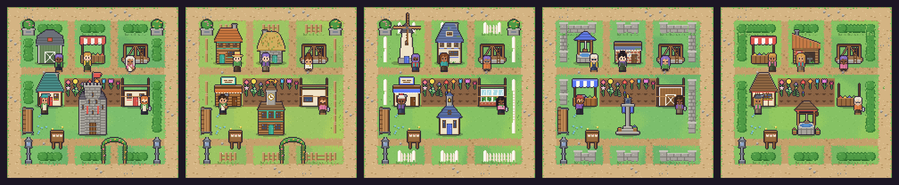
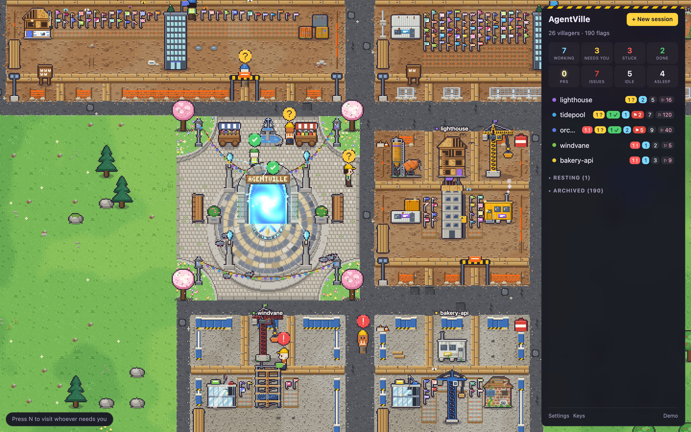
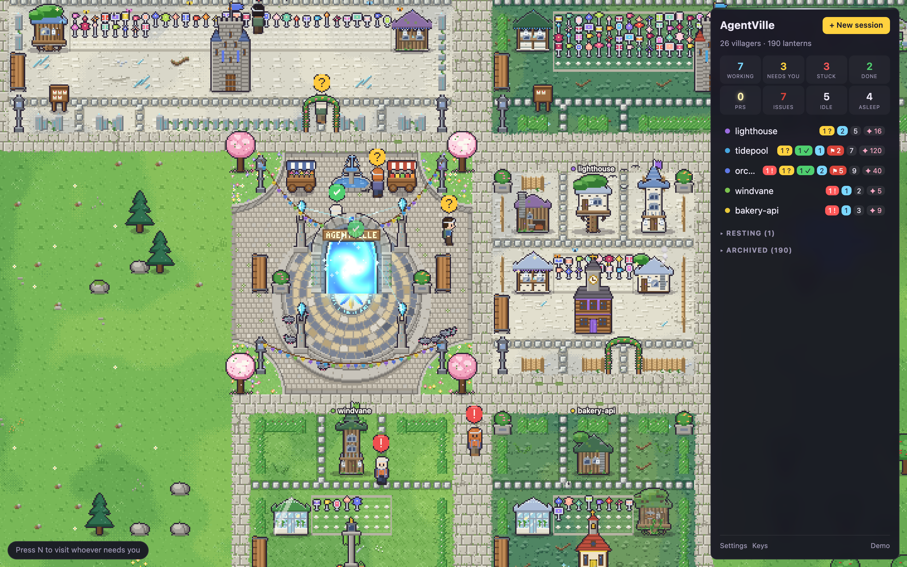
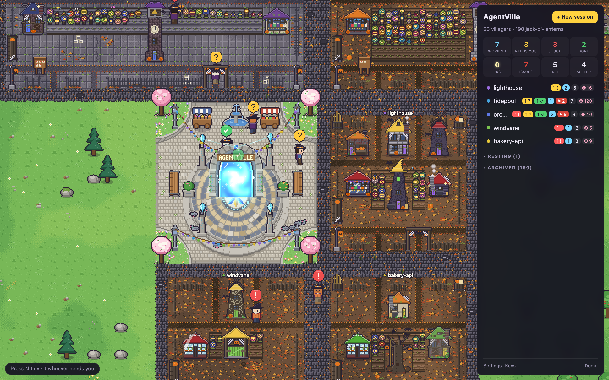
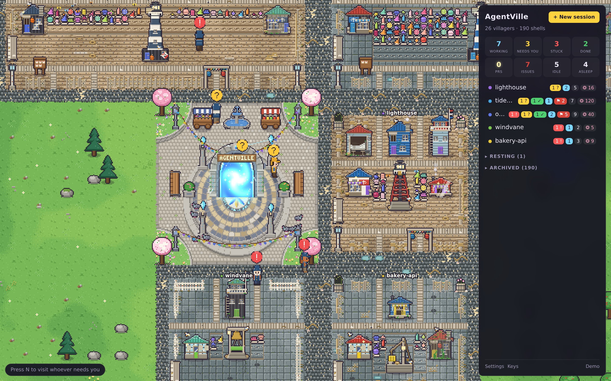
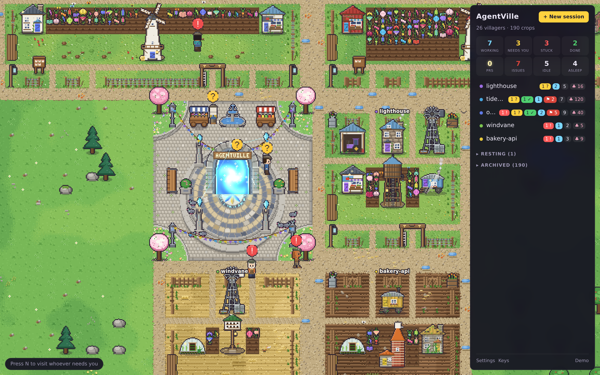

# Themes

A **theme** is the whole village's look. A **sub-theme** is one folder's take on it: each plot
wears one, so the repos in a village tell each other apart without leaving the theme.

- **Settings → Theme** dresses the whole village.
- **Settings → Every folder** puts every folder in one sub-theme instead of a spread.
- **Look**, in a folder's panel, gives that folder any theme's sub-theme and keeps it whatever the
  village becomes — so a roadworks site can stand in a countryside village.
- `?demo&theme=<id>` (and `&sub=<sub-theme>`) shows a theme over the demo village without saving
  anything.

Whatever a village wears, what things **mean** is the same: status badges, the selection ring, lit
windows and chimney smoke. Finished work may be drawn as something other than a flower, but it
still shows the kind of work, white for an unlabeled PR, and a bud for an open one. Every plot's
**landmark** climbs six tiers as the repo's work adds up; a theme names and draws its own, or
leaves the village's standing.

---

## Countryside village · `village`

The village it has always been: lanes, hedges, cottages and a flower per finished thread in each
plot's garden.



| Sub-theme | `id` | |
| --- | --- | --- |
| Patchwork | `patchwork` | A bit of everything: each repo its own mix of fences, walls and roofs |
| Farmstead | `farmstead` | Split-rail fences, weatherboard walls and a golden lawn |
| Market town | `market-town` | White pickets, brick and plaster fronts, warm roofs |
| Stone hamlet | `stone-hamlet` | Dry-stone walls, stone cottages and slate-blue roofs |
| Tudor lane | `tudor-lane` | Box hedges and half-timbered houses |

**Built from** — fences: rail, picket, stone, hedge · lawns: fresh, deep, golden · walls: plaster,
wood, stone, brick, timber · four families of roof colour.
**Finished work**: a **flower** in the **garden** (✿). **Work clothes**: their own.
**Landmark**: a campfire, a well, a market cross, a chapel, a town hall, a keep; each tier brings a
lamp, a bench, planters, a rose arch and a second lamp to the fence line.
**Handed out**: every folder gets Patchwork unless it picks otherwise, so a village nobody has
touched looks as it always has.

---

## Construction site · `construction`

Every plot fenced off and every session's building going up: a timber frame, a tower crane, a site
office, a digger in its pit.


| Sub-theme | `id` | |
| --- | --- | --- |
| New homes | `new-homes` | Timber frames and brick going up behind mesh fencing |
| High-rise | `high-rise` | Steel and glass on a concrete slab, cranes overhead |
| Roadworks | `roadworks` | Barriers, cones and fresh concrete, everybody in orange |
| Restoration | `restoration` | Old brick wrapped in scaffolding behind painted hoarding |
| Industrial park | `industrial` | Steel sheds, shipping containers and a batching plant |

**Built from** — fences: mesh, hoarding, barrier, netting · ground: gravel, dirt, sand, slab ·
walls: timber, brick, concrete, steel, glass · four families of machine paint.
**Finished work**: a **survey flag** in the **setting-out yard** (⚐) — a pennant for a bug fix, a
chequered flag for data, a windsock for research. **Work clothes**: a hard hat and hi-vis.
**Landmark**: a survey peg, a site hut, a scaffold tower, a tower crane, a concrete core, a tower
topped out with a tree and the plot's flag; the fence line gets a lighting mast, stacked boards,
cones and a barrier, and a site entrance.



---

## Elvish realm · `elvish`

A wood the elves keep: homes grown into living trees and carved from white stone under swept
roofs, ways paved in pale flagstones, lanterns lit for whatever is done.


| Sub-theme | `id` | |
| --- | --- | --- |
| Greenwood | `greenwood` | Homes grown into living trees under woven leaf canopies |
| Silver wood | `silverwood` | Birch and white stone under moonlit silver roofs |
| River hall | `riverhall` | Carved white halls and crystal glazing beside the water |
| Golden bough | `goldenbough` | Mallorn gold and deep leaf loam, everything lantern-warm |
| Thorn hold | `thornhold` | Briars, runestones and twilight violet over deep moss |

**Built from** — fences: woven withy, briar, mithril filigree, runestones · ground: glade, moss,
leaf loam, river sand · walls: livewood, birch, pale stone, woven leaf, crystal · four families of
roof colour.
**Finished work**: a **lantern** lit on its stand in the **lantern grove** (✦) — a teardrop lamp
for a bug fix, a rune lantern for data, a wisp for tests, a seeker's lamp for research.
**Work clothes**: a mithril circlet and a travelling cloak.
**Landmark**: a fairy ring of glowing toadstools, a moonstone, a star shrine, a silver tree, a
crystal hall, and the starwatch, a white tower with a star-crystal in its crown; the fence line
gets lanterns on crooks, a stone seat, urns of fern and toadstools, and two saplings grown into an arch.



---

## Halloween night · `halloween`

The last night of October: lanes of dark setts under the fallen leaves, gabled houses shingled and
boarded, a jack-o'-lantern on every step, and cobwebs in every corner.


| Sub-theme | `id` | |
| --- | --- | --- |
| Pumpkin patch | `pumpkin-patch` | Corn stooks, straw and leaf mould, and pumpkins everywhere |
| Haunted manor | `haunted-manor` | Tall shingled houses behind iron railings, boarded windows lit green |
| Graveyard | `graveyard` | Grey stone and wrought iron, headstones and fog in the hollows |
| Witch's hollow | `witchs-hollow` | Crooked daubed cottages, cauldrons on the boil and toadstools |
| Trick-or-treat lane | `trick-or-treat` | Cheerful brick fronts, paper bats and a string of orange lights |

**Built from** — fences: crooked pickets, wrought iron, corn stalks, a string of lanterns · ground:
frosted grass, leaf mould, turf under fog, old flagstones · walls: weatherboard, churchyard
granite, sooty brick, daub and timber, fish-scale shingles · five families of paint.
**Finished work**: a **jack-o'-lantern** carved and lit in the **pumpkin patch** (☻) — a grinning
lantern for a bug fix, a grid-carved one for data, a little gourd for tests, an owl for research.
An open pull request's pumpkin is grown but not yet cut open.
**Work clothes**: a witch's hat and a cape.
**Landmark**: a heap of lanterns, a scarecrow, a lych-gate, a gnarled oak hung with lanterns, a
witch's tower with a cauldron at its foot, and a belfry with the bats going out of it; the fence
line gets an iron lamp post with a lantern on its crook, a weathered bench, a barrel of corn
stalks and a tub of gourds, and two posts hung with bunting.
**Depicted**: the graveyard's headstones are plain tablets and its gate a lych-gate, with no
religious symbols carved on them, and nothing of Día de los Muertos, which has a theme of its own
coming. Costume stays on the hat and the cape.



---

## Seaside harbour · `seaside`

A working harbour: quay flags and boardwalks, nets drying on the fences, lobster pots stacked along
the wall, and a lighthouse standing over the plot that has done the most.


| Sub-theme | `id` | |
| --- | --- | --- |
| Fishing harbour | `fishing-harbour` | Wet quay flags, nets on the fence, lobster pots stacked along the wall |
| Beach huts | `beach-huts` | Rows of brightly painted huts on the sand behind a rope walk |
| Lighthouse point | `lighthouse-point` | Whitewash and shore stone on the shingle, a railing along the point |
| Boatyard | `boatyard` | Tarred sheds and galvanised roofs, hulls on the slipway, rope and sawdust |
| Cliffside cottages | `cliff-cottages` | Whitewashed cottages above the shore, railings and steps down to it |

**Built from** — fences: rope on bollards, drying net, groyne baulks, painted railing · ground:
sand, shingle, boardwalk decking, wet quay flags · walls: painted clinker boarding, limewash,
tarred boarding, shore stone, galvanised sheet · five families of paint.
**Finished work**: a **shell** set out on the **strand** (❂) — a scallop for a bug fix, a
cuttlebone for docs, a net float for data work, a nautilus for research, a mooring buoy for
infrastructure. An open pull request's find is still half buried in the sand.
**Work clothes**: a sou'wester and an oilskin, yellow on most crews and navy in the boatyard.
**Landmark**: a mooring post, a boat hauled up on the shingle, the fog bell on its frame, a quay
derrick with a crate on the hook, the pier light, and the lighthouse itself with its beam going
round; the fence line gets a painted lamp post, a slatted bench, a half-barrel of marram grass or
sea thrift, and two posts hung with signal flags and floats.
**Drawn its own way**: the birds over a harbour are gulls, since the whole village's theme is what
the renderer asks a bird for. The open water between the plots and the arrival square stay the
village's, so a harbour plot can stand in any village.



---

## Working farm · `farm`

A working farm: red barns and silos, pasture and stubble behind post-and-rail, hens in the yard,
and a windmill turning over the plot that has done the most.


| Sub-theme | `id` | |
| --- | --- | --- |
| Red barn | `red-barn` | Red board barns with white trim behind post-and-rail, hens in the yard |
| Dairy | `dairy` | Whitewashed byres and stone, white paddock rails and good grass |
| Grain farm | `grain-farm` | Golden stubble, tin sheds and silos, bales stacked along the wire |
| Orchard | `orchard` | Silvered weatherboard and old stone, windfalls in the grass |
| Market garden | `market-garden` | Fresh-turned furrows, wattle hurdles and polytunnels, everybody in brown |

**Built from** — fences: post and rail, stock wire, wattle hurdles, white paddock boards ·
ground: pasture, stubble, furrows, trodden farmyard · walls: painted board and batten, silvered
weatherboard, fieldstone, whitewash, corrugated tin · five families of paint.
**Buildings**: a farmhouse, a shepherd's hut on iron wheels, a farm shop, a gambrel-roofed barn,
a windpump with its wheel turning, a machine shed with the tractor in it, a pump and trough, a hen
house and its run, a grain silo, a polytunnel and an honesty stall.
**Finished work**: a **crop** in the **kitchen garden** (♣) — a tomato for a bug fix, a
sunflower for a new feature, a carrot for a refactor, a cabbage for docs, a pea pod for tests, a
corn cob for data work, a pumpkin for infrastructure, a runner bean for research. An open pull
request's crop is still green on the plant.
**Work clothes**: a tweed flat cap and dungarees, denim on most farms and brown duck canvas in the
market garden.
**Landmark**: a stack of bales, a scarecrow, a dovecote on its post, an oast house, a water tower,
and a windmill with its sails going round; the fence line gets a lantern on a crook, a bench of
planks on two bales, a retired milk churn or a half-barrel of marigolds, and gateposts with the
farm's board across them.
**Rooms**: a farmhouse kitchen, a hay loft and a potting shed.



## Thanksgiving harvest · `thanksgiving`

A village on harvest day: corn stalks tied to posts, pumpkins on every step, pies cooling on the
sills and a long table set outside under bunting.

| Sub-theme | `id` | |
| --- | --- | --- |
| Harvest farm | `harvest-farm` | Red barnwood and log walls, corn stalks tied to the posts, hay in the yard |
| Family homes | `family-homes` | Cream clapboard and brick, pies cooling on the sills and a long table set outside |
| Autumn woods | `autumn-woods` | Log cabins and fieldstone under drifts of fallen leaves and split rails |
| Pie bakery | `pie-bakery` | Brick ovens, striped awnings and pies by the dozen behind white pickets |

**Built from** — fences: corn shocks on posts, stacked hay, split rails, white pickets ·
ground: fallen leaves, golden lawn, russet earth, flagstones · walls: clapboard, barnwood, logs,
fieldstone, brick · four families of paint.
**Buildings**: a family homestead, a log cabin, a bakery, a harvest barn and a long outdoor table.
**Finished work**: a **gourd** in the **harvest patch** (❧) — a pumpkin for a bug fix, a corn
stalk for a new feature, a butternut squash for a refactor, a wheat sheaf for docs, cranberries for
tests, Indian corn for design, a corn cob for data work. An open pull request's gourd is still green
on the vine.
**Landmark**: the village's own.
**Rooms**: a family kitchen, a harvest barn, a pie pantry and a woodland cabin.

## Holi · `holi`

A village on the day of colours: clouds of gulal powder over the lanes, splashes on every wall,
marigold garlands from the posts and a pichkari leaning by many a door. Everybody is in a white
tunic splashed with colour.

| Sub-theme | `id` | |
| --- | --- | --- |
| Colour lanes | `colour-lanes` | Walls and roads splashed pink, green, yellow and blue, with clouds of gulal in the air |
| Flower Holi | `flower-holi` | Petals underfoot, garlands of marigold and rose strung from every post |
| Bonfire square | `bonfire-square` | A stack of logs ready for the Holika Dahan fire, lit at night |
| Courtyard homes | `courtyard-homes` | Flat rooftops and open courtyards, with colour on every wall and balcony |

**Built from** — fences: splashed whitewash walls, marigold garlands, bamboo, stacked logs ·
ground: powder-dusted stone, petals, terracotta flags, swept ash · walls: whitewash, pink, yellow
and blue limewash, sandstone · four families of paint.
**Buildings**: a flat-roofed family home, a lane house, a colour shop, a gate hall and the bonfire stack.
**Finished work**: a **pot of gulal** at the **colour stall** (✺), one shape of pot per kind of
work: a matka for a bug fix, a tall urn for a feature, a trio of cups for tests, a surahi for
performance. An open pull request's pot is still covered with a cloth; white powder is an
unlabeled PR.
**Landmark**: the village's own.
**Rooms**: a colour room, a bonfire hall, a garland workshop and a courtyard room.

## New Year's Eve · `new-years-eve`

A village counting down to midnight: bunting across the street, party lights on every roof, a
party hat on every villager and a sparkler going off at each finished job. Best seen at night.

| Sub-theme | `id` | |
| --- | --- | --- |
| Rooftop party | `rooftop-party` | Party lights and a rooftop dance floor, balloons tied to the rails |
| Midnight square | `midnight-square` | A clock tower counting down, bunting across the street and confetti underfoot |
| Cosy cabin | `cosy-cabin` | A quiet night in the snow: logs, a string of lights and sparklers by the door |
| Ballroom | `ballroom` | A grand hall of marble and gilt, chandeliers in every window and a band on the stage |

**Built from** — fences: bunting, string lights, velvet rope on gilt stanchions, balloons ·
ground: confetti pavement, night lawn, dance floor, snow · walls: midnight plaster, stucco, soot
brick, marble, logs · four families of paint.
**Buildings**: a party house, a snowy cabin, a clock tower, a ballroom and a bandstand.
**Villagers**: everyone wears a party hat in their own colour.
**Finished work**: a **sparkler** in the **celebration** (✶) — a sparkler for a bug fix, a Roman
candle for a feature, a party popper for a refactor, a party horn for docs, a bunch of sparklers
for tests, a pinwheel for design, a confetti cannon for infrastructure, a noisemaker for data, a
rocket for performance, a fountain for a review, a wishing lantern for research, a party hat for
odds and ends. An open pull request's is not lit yet.
**Landmark**: the village's own.
**Rooms**: a rooftop lounge, a clock room, a ballroom and a cabin nook.

## Independence Day · `independence-day`

The Fourth of July: flagpoles and bunting on every porch, a parade down main street, picnic
blankets and watermelon, fireworks waiting by the lake.

| Sub-theme | `id` | |
| --- | --- | --- |
| Main street parade | `main-street` | Brick fronts and white clapboard, a flagpole at every door and a banner across the street |
| Picnic park | `picnic-park` | Red barn pavilions on a mown lawn, hay bales to sit on and watermelon on the grass |
| Lakeside fireworks | `lakeside` | Log cabins and stone boathouses on the shingle, bunting along the water and rockets waiting |
| Small-town porches | `porch-town` | White clapboard with a flag on every porch rail, apple pie on the sill and a picket fence |

**Built from** — fences: flag posts on a rope, hay bales, bunting rails, white pickets ·
ground: confetti-strewn lawn, mown park lawn, lakeside shingle, sidewalk slabs · walls: clapboard,
red barn, logs, fieldstone, brick · four families of red, white and blue paint.
**Buildings**: a porch house, a log cabin, a shop with a striped awning, a party barn and a long picnic table under bunting.
**Finished work**: a **flag** in the **flag bed** (★) — a flag on a pole for a bug fix, a rocket
for a feature, a pinwheel for a refactor, a scroll for docs, sparklers for tests, bunting for design,
a barbecue grill for infrastructure, a star for data, a roman candle for performance, a liberty bell
for a review. An open pull request's is not lit yet: the same shape in grey.
**Landmark**: the village's own.
**Rooms**: a porch parlour, a picnic pavilion, a parade hall and a lake cabin.

## Making one

Follow the `new-theme` skill in [`.claude/skills/new-theme/`](../../.claude/skills/new-theme/SKILL.md).
A theme is two things: its names and recipes in [`src/sim/themes.js`](../../src/sim/themes.js),
which run under Node, and its pack in [`src/render/themes/<id>/`](../../src/render/themes), which
decides what they look like. A pack draws only what makes the theme itself; whatever it passes on
is drawn the village's way, so plots of different themes stand side by side.
`test/theme-packs.test.mjs` holds every registered theme to the rules the renderer relies on, as
soon as it is registered.

## The pictures here

The plot strips are contact sheets, not screenshots: no real village, repo or path is in them.

```
npm run sheet -- <id> --only plots --scale 2 --out docs/themes/<id>.png
```

The full-window shots come from the demo village through `npm run shots`; see
[`docs/screenshots/`](../screenshots).

## Eid · `eid`

A village for the festival: fanous lanterns on every post, crescent-and-star garlands, tiled
courtyards and trays of dates and sweets. Religious symbols stay on the buildings and fences, not on
the villagers. The calendar doesn't dress the village for it yet: Eid follows the lunar calendar, so
it is chosen in **Settings → Theme**.

| Sub-theme | `id` | |
| --- | --- | --- |
| Lantern souk | `lantern-souk` | Arcaded stalls of lanterns, sweets and textiles under strings of lights |
| Courtyard homes | `courtyard-homes` | Whitewashed walls round tiled courtyards, a fountain and a lamp in every one |
| Night garden | `night-garden` | Palms and string lights over lawn, a crescent hung above the square |
| Sweets street | `sweets-street` | Bakeries of ma'amoul and kahk, trays of dates and families visiting |

**Built from** — fences: lantern posts, a tiled low wall, a carved lattice, a garland ·
ground: sand, garden lawn, courtyard pavers, mosaic · walls: whitewash, sandstone, tilework, clay,
carved screen · four families of paint.
**Finished work**: a **lantern** in the **lantern bed** (☼), one silhouette per kind of work; an
open PR's is not lit yet.
**Rooms**: a tiled courtyard, a souk stall, a sweets kitchen and a garden pavilion.

## Hanukkah · `hanukkah`

A village for the festival of lights: a hanukkiah in the windows, blue and white with silver, stars on
the bunting, dreidels and gelt, sufganiyot and latkes. Religious symbols stay on the buildings and
fences, not on the villagers. The calendar doesn't dress the village for it yet: Hanukkah follows the
Hebrew calendar, so it is chosen in **Settings → Theme**. Candles lit do not yet follow the night of the festival.

| Sub-theme | `id` | |
| --- | --- | --- |
| Window lights | `window-lights` | Homes with a hanukkiah lit in every window facing the street |
| Blue and silver street | `blue-silver-street` | Blue-and-white bunting and lights, a large hanukkiah in the square |
| Bakery row | `bakery-row` | Sufganiyot and latkes, warm windows over the counters |
| Dreidel courtyard | `dreidel-courtyard` | Children's games, gelt and lanterns in a snowy courtyard |

**Built from** — fences: candle posts, a low wall, a lattice, bunting · ground: cobbles, winter lawn,
snow, tile · walls: whitewash, limestone, tilework, brick, lattice screen · four families of paint.
**Finished work**: a **candle** in the **candle bed** (❂), one silhouette per kind of work; an open PR's is not lit yet.
**Rooms**: a lit parlour, a festival hall, a frying kitchen and a game room.
**Left out / unsure**: the buildings are the Eid pack's shapes re-coloured, so a few props (lanterns, a palm and dates
by a door) are still festival-generic, and the square's large hanukkiah and nine-branch candelabra on buildings are not
drawn yet (only the spotlight marker). Said here rather than guessed at.
